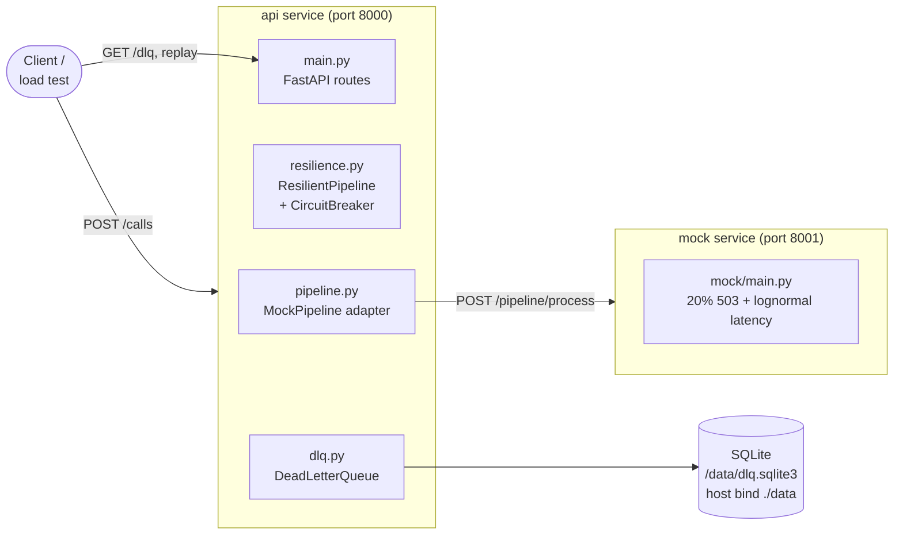
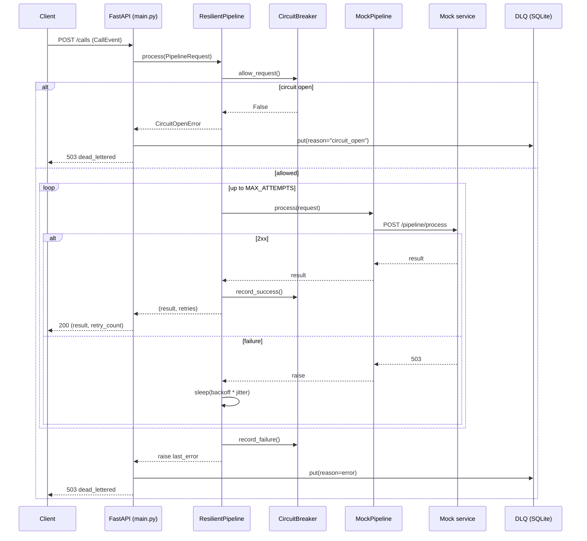
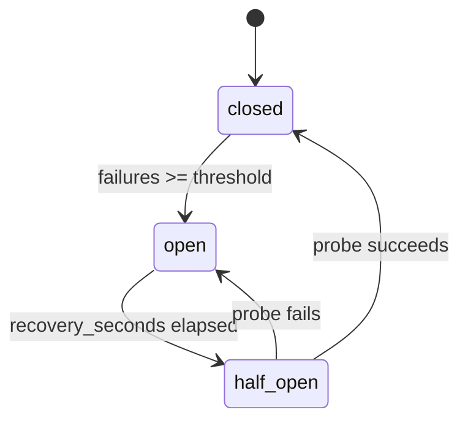

# Collections Agent — Architecture & Module Guide

This document explains every working piece of the Track 1 codebase: what each module
does, how the pieces fit together, and how a request flows through the system.

---

## 1. What this service is

The service is a **collections inference API**. It accepts a "call event" for a borrower
and runs it through a downstream **STT → LLM → TTS pipeline** (here represented by a mock).
Because downstream model calls are unreliable in practice, the service wraps that pipeline
in a **resilience layer** (timeouts, bounded retries with jittered backoff, and a circuit
breaker) and, when a logical event ultimately fails, persists it to a **dead-letter queue
(DLQ)** for later inspection and replay.

The architecture is deliberately split so that **policy** (retry/breaker) never knows about
**vendors** (Whisper, Mistral, Piper, etc.), and so that **transport** (HTTP) never knows
about **storage** (SQLite).

---

## 2. Repository layout

```
collections-agent-track1/
├── app/                      # The primary service (FastAPI)
│   ├── __init__.py           # Empty package marker
│   ├── config.py             # Environment-driven configuration constants
│   ├── models.py             # Pydantic request/response schemas + domain literals
│   ├── pipeline.py           # Pipeline Protocol + MockPipeline HTTP adapter
│   ├── resilience.py         # CircuitBreaker + ResilientPipeline (retry/backoff)
│   ├── dlq.py                # DeadLetterQueue (SQLite) + DynamoDB backend + factory
│   └── main.py               # FastAPI app, routes, wiring, lifespan hooks
├── mock/                     # Mock STT/LLM/TTS dependency (separate service)
│   ├── main.py               # FastAPI mock with 20% failure + lognormal latency
│   └── Dockerfile
├── scripts/
│   ├── traffic_profile.py      # Appendix C rate-schedule runner (ramp/hold, demo mode)
│   ├── latency_sample.py       # Measures the mock's p50/p90/p99 without sleeping
│   ├── load_test.py            # Concurrent smoke load test against /calls
│   └── generate_events.py      # Prints synthetic CallEvent JSON lines
├── tests/
│   ├── conftest.py           # Fixtures: temp DB, app factory, in-process mock client
│   ├── helpers.py            # Deterministic adapters + controllable clock
│   ├── unit/                 # Retry, circuit breaker, DLQ unit tests
│   ├── api/                  # /calls, /dlq, /health, /ui route tests
│   └── integration/          # Mock scenarios + full E2E pipeline tests
├── app/static/index.html     # Browser E2E testing dashboard served at GET /ui
├── docker-compose.yml        # Runs api + mock, bind-mounts host ./data for SQLite
├── Dockerfile                # Builds the api image
├── requirements.txt          # Python dependencies
├── .env.example              # Documented environment overrides
├── COST_WRITEUP.md           # Fargate cost estimate (Appendix D)
├── MODEL_SWAP.md             # How to replace the mock with real models
└── README.md
```

---

## 3. High-level architecture



**Key idea:** `main.py` owns HTTP concerns and wiring only. All reliability behavior lives
in `resilience.py`, and all downstream-specific behavior lives in the adapter (`pipeline.py`).
`dlq.py` is the only module that touches storage.

---

## 4. Module-by-module walkthrough

### 4.1 `app/config.py` — Configuration

**Purpose:** single source of truth for tunables, all overridable via environment variables.

| Constant | Env var | Default | Meaning |
|---|---|---|---|
| `MOCK_URL` | `MOCK_URL` | `http://mock:8001` | Base URL of downstream pipeline |
| `DATABASE_PATH` | `DATABASE_PATH` | `/data/dlq.sqlite3` | SQLite file location (used when `DLQ_BACKEND=sqlite`) |
| `DLQ_BACKEND` | `DLQ_BACKEND` | `sqlite` | DLQ backend: `sqlite` or `dynamodb` |
| `DLQ_TABLE_NAME` | `DLQ_TABLE_NAME` | _(none)_ | DynamoDB table; required when `DLQ_BACKEND=dynamodb` |
| `MAX_ATTEMPTS` | `MAX_ATTEMPTS` | `3` | Total HTTP attempts per logical event |
| `BASE_DELAY_SECONDS` | `BASE_DELAY_SECONDS` | `0.2` | First backoff delay |
| `MAX_DELAY_SECONDS` | `MAX_DELAY_SECONDS` | `2` | Backoff ceiling |
| `REQUEST_TIMEOUT_SECONDS` | `REQUEST_TIMEOUT_SECONDS` | `3` | Per-request HTTP timeout |
| `CB_FAILURE_THRESHOLD` | `CB_FAILURE_THRESHOLD` | `5` | Failed logical events before breaker opens |
| `CB_RECOVERY_SECONDS` | `CB_RECOVERY_SECONDS` | `10` | Cooldown before a half-open probe |

Because everything is read from `os.getenv` at import time, the same image can be tuned
per environment without rebuilding (see `docker-compose.yml` and `.env.example`).

---

### 4.2 `app/models.py` — Schemas and domain vocabulary

**Purpose:** validate and shape all data crossing the API boundary and the pipeline boundary.

- **Literal aliases** constrain inputs to known values:
  - `BorrowerBucket`: `"0-30 DPD"`, `"31-60 DPD"`, `"61-90 DPD"`, `"90+ DPD"`
  - `ProductType`: `"credit_card"`, `"bnpl"`, `"personal_loan"`
  - `Outcome`: `"connected"`, `"no_answer"`, `"ptp_taken"`, `"dispute"`, `"failed_downstream"`
- **`CallEvent`** is the inbound event model. It mirrors Appendix A exactly:
  - **Required** — `event_id` (parsed as a **UUID**; doubles as the DLQ idempotency key),
    `campaign_id`, `borrower_bucket`, `timestamp` (date-time), `outcome`.
  - **Optional** — `product_type`, `call_duration_s` (`>= 0`), `retry_count` (`>= 0`).
  - The dashboard, scripts and fixtures always generate valid synthetic UUIDs.
- **`PipelineRequest`** is the minimal message sent downstream (`event_id` + `audio_ref`).

Pydantic gives automatic request validation: malformed events are rejected by FastAPI with
a 422 before any handler code runs.

---

### 4.3 `app/pipeline.py` — The dependency boundary

**Purpose:** define *what* a pipeline is, and provide the mock/HTTP implementation.

- **`Pipeline` (a `typing.Protocol`)**: the contract — any object with
  `async process(request: PipelineRequest) -> dict` qualifies. This is the seam that makes
  the service vendor-agnostic (see `MODEL_SWAP.md`).
- **`MockPipeline`**: the concrete adapter. It receives an injected `httpx.AsyncClient`,
  POSTs to `/pipeline/process` and calls `raise_for_status()`. The resilience layer
  classifies the resulting exceptions: HTTP **5xx** are retryable, HTTP **4xx** are
  permanent (`NonRetryableError`, never retried).

Swapping to real models means writing one new class implementing `process(...)`; nothing in
`resilience.py`, `dlq.py`, or `main.py` needs to change.

---

### 4.4 `app/resilience.py` — Reliability policy

This is the heart of the challenge. It contains two classes.

#### `CircuitBreaker` (a dataclass)

A three-state machine that prevents hammering a failing dependency.

| State | Behavior |
|---|---|
| `closed` | Normal. `allow_request()` returns `True`. |
| `open` | All requests rejected until `recovery_seconds` elapse. |
| `half_open` | A single trial "probe" request is allowed through. |

Transitions:
- `closed → open`: after `failure_threshold` **failed logical events** (`record_failure`).
- `open → half_open`: once `recovery_seconds` have passed since `opened_at`.
- `half_open → closed`: on `record_success()` (resets failure count).
- `half_open → open`: if the probe fails (re-opens immediately).

`probe_in_flight` ensures only **one** half-open probe runs at a time, avoiding a thundering
herd during recovery. `release_probe()` clears the probe flag when an in-flight probe is
cancelled, so the breaker never wedges half-open. All mutations happen without `await`, so
each transition is atomic with respect to the event loop.

#### `ResilientPipeline`

Wraps any `adapter` (a `Pipeline`) with retry + breaker policy.

```
process(request):
    if breaker disallows:            -> raise CircuitOpenError
    try:
      for attempt in range(max_attempts):
        try:  result = await adapter.process(request)
              breaker.record_success(); return result, attempt
        except:
              if not retryable(exc) or last attempt: break
              sleep(backoff * jitter)
      breaker.record_failure()       # one failure per LOGICAL (retryable) event
      last_error.retries = actual retries   # accurate even for non-retryable
      raise last_error
    except CancelledError:
      breaker.release_probe(); raise
```

Important design choices:
- **Jittered exponential backoff**: `min(BASE * 2**attempt, MAX) * random(0.8, 1.2)`
  spreads retries so many clients don't retry in lockstep.
- **Retryability** (`is_retryable`): HTTP 5xx / timeouts / transport errors retry;
  HTTP 4xx, pydantic/ValueError/TypeError and adapter-raised `NonRetryableError` do **not**
  (they are permanent and skip straight to the DLQ after one attempt).
- **The breaker counts logical events, not HTTP attempts** — one exhausted retryable event
  is one failure, so a transient blip that succeeds on retry does *not* trip the breaker,
  and permanent errors never trip it either.
- The returned `attempt` value is the **retry count** (0 means first attempt succeeded).
  On terminal failure the raised exception carries `.retries` (the actual number of retries
  performed) so the DLQ stores an accurate count, not a naive `MAX_ATTEMPTS - 1`.
- **Cancellation safety**: if a request is cancelled mid-flight (e.g. a half-open probe),
  the breaker's probe flag is released so the next request can probe again.

---

### 4.5 `app/dlq.py` — Dead-letter storage

**Purpose:** durable landing zone for events that exhausted retries or hit an open circuit.

Two interchangeable implementations share one synchronous interface
(`put`/`list`/`get`/`set_status`/`claim`), chosen by `dlq_from_env()` from
`DLQ_BACKEND`:

- **`sqlite`** (default) — `DeadLetterQueue`, stdlib `sqlite3` at `DATABASE_PATH`.
  Used for local development, `docker compose` and the test suite; needs no AWS
  access.
- **`dynamodb`** — `DynamoDBDeadLetterQueue`, one shared table named by
  `DLQ_TABLE_NAME`. Used by the ECS API task so dead letters survive task
  replacement and are visible to every task behind the load balancer. Selecting
  it without a table name raises `MissingDlqConfigError` at startup (fail fast).

The methods are synchronous; `app/main.py` invokes them through
`asyncio.to_thread` so the DynamoDB-backed path never blocks the event loop. The
SQLite-specific details below also describe the DynamoDB item shape, which
mirrors the same columns (with `payload` stored as a JSON string).

- The SQLite backend uses **SQLite** (`sqlite3`, stdlib) at `DATABASE_PATH`; the table is created on first
  construction with `CREATE TABLE IF NOT EXISTS`.
- Schema (`dead_letters`):

| Column | Notes |
|---|---|
| `event_id` | `PRIMARY KEY` (idempotency key) |
| `payload` | JSON-encoded `CallEvent` |
| `failure_reason` | e.g. `circuit_open` or error text |
| `retry_count` | attempts made |
| `status` | `pending` / `processing` / `completed` |
| `created_at`, `updated_at` | UTC ISO timestamps |

- `put()` uses **UPSERT** (`ON CONFLICT(event_id) DO UPDATE`) so reprocessing the same event
  overwrites its row and resets status to `pending` — idempotent writes.
- `get()` / `list()` deserialize `payload` back to a dict.
- `set_status()` transitions state during replay, optionally recording a new reason.
- `claim()` atomically flips a row to `processing` with a single guarded `UPDATE`, so two
  concurrent replays cannot both win (one 200, the others 409).

`_conn()` is a small context manager that yields a connection with `row_factory =
sqlite3.Row` and a 10s busy timeout, **commits on success, rolls back on error, and always
closes** — database failures propagate to the caller rather than being silently swallowed.
It is specific to the SQLite backend.

The DynamoDB backend reproduces the same semantics with single conditional
`UpdateItem` calls: `put()` uses `if_not_exists(created_at, :c)` to preserve the
original timestamp on re-dead-lettering, `set_status()` guards with
`attribute_exists(event_id)` so a missing event is a no-op (not a partial item),
and `claim()` guards with `attribute_exists(event_id) AND #s <> :processing` so
concurrent replays across tasks stay exclusive. Its boto3 client is created
lazily on first use with short connect/read timeouts.

---

### 4.6 `app/main.py` — HTTP surface and wiring

**Purpose:** expose the API and connect all modules. It owns no business logic beyond
translating exceptions into HTTP responses.

**App state (module globals):** `dlq`, `http_client`, `resilient`.

**App factory & lifespans:** `create_app(...)` builds the app so it can be
constructed with injected dependencies for tests (`dlq`, `resilient`,
`mock_client`, `enable_test_controls`). The default production app creates one
shared `httpx.AsyncClient` (`base_url=MOCK_URL`) and the `ResilientPipeline`
during lifespan startup, and closes the client on shutdown.

**Routes:**

| Method | Path | Behavior |
|---|---|---|
| `GET` | `/health` | Liveness + current breaker state |
| `GET` | `/dependencies` | Aggregate API + mock health (used by `/ui`) |
| `POST` | `/calls` | Process an event through the resilient pipeline |
| `GET` | `/dlq` | List all dead-lettered events |
| `GET` | `/dlq/{event_id}` | Fetch one dead-lettered event (404 if missing) |
| `POST` | `/dlq/{event_id}/replay` | Re-run a dead-lettered event |
| `GET` | `/ui` | Browser E2E testing dashboard |
| `GET` | `/` | Redirect to `/ui` |
| `GET` | `/test/scenarios` | Report test-control mode + config |
| `POST` | `/test/circuit/reset` | Force breaker closed (test controls only, 403 otherwise) |

The optional `X-Test-Scenario` header is honored only when
`ENABLE_TEST_CONTROLS=true`, and is forwarded to the mock to trigger
deterministic failures. See `docs/USAGE.md` for the full endpoint contract.

**`POST /calls` flow:**
1. Build `PipelineRequest` from the `CallEvent` (`audio_ref="synthetic"`).
2. `await resilient.process(request)` → on success return the pipeline result + retry count.
3. On `CircuitOpenError` → store with reason `circuit_open`, return **503**.
4. On any other exception → store with the error text, return **503**.
   Both failures are dead-lettered before returning, so nothing is silently lost.

**Replay flow (`POST /dlq/{id}/replay`):**
- 404 if unknown; **409** if already `processing` (guards against concurrent replay).
- Atomically claims the row (`dlq.claim`) so two parallel replays cannot both proceed.
- Re-runs the resilient pipeline over the stored payload.
- Success → status `completed`; failure → back to `pending` with the new reason and **503**.
  Replay reuses the *same* resilience path, so it inherits retries and the breaker.

---

### 4.7 `mock/main.py` — The downstream dependency simulator

A standalone FastAPI app on port 8001 that emulates the STT/LLM/TTS service so the
resilience behavior can be exercised deterministically in aggregate.

- `GET /health` → `{"status": "ok"}`.
- `POST /pipeline/process`:
  - By default ~**20% of HTTP requests return 503** (`downstream_timeout`) — independent per
    request, injected *before* any latency, matching the challenge spec.
  - Otherwise it samples **lognormal latency** `max(1, int(lognormvariate(5.7, 0.62)))` ms
    (median ≈ 300 ms; measured p90 ≈ 663 ms, p99 ≈ 1278 ms), sleeps that long, and returns
    the **sampled** latency — so `latency_ms` is deterministic, not a wall-clock reading.
  - When `ENABLE_TEST_CONTROLS=true`, a request may instead select a deterministic
    scenario (`always_succeed`, `fail_once_then_succeed`, `always_fail`, `slow`) via the
    `scenario` field; unknown scenarios return 400.

Because failure is *per HTTP request*, retries at the API layer convert a 20% per-attempt
failure into a much lower **per-logical-event** failure rate.

---

### 4.8 `tests/` — Test suite

Organized into `unit/`, `api/` and `integration/`, with shared fixtures in
`tests/conftest.py` and deterministic test doubles in `tests/helpers.py`. Every
test uses a temporary SQLite database and never relies on the mock's random 20%
path. See `docs/USAGE.md` §10 for the file layout, markers and commands.

---

### 4.9 `scripts/` — Traffic simulation and data generation

- **`traffic_profile.py`**: the **Appendix C runner**. Computes the target rate for
  "now" from the schedule table (10/min baseline; 08–10 and 14–16 ramps 10→50 over
  15 min then hold; baseline otherwise), advances simulated time with an accelerated
  clock, and fires valid Appendix A events with bounded concurrency and a capped launch
  queue (no unbounded buffering). Reports planned vs. actual rates, success/failure,
  retries, observed-latency percentiles, and final DLQ depth. `--demo` compresses a full
  day into ~24 s at reduced volume while still traversing both spikes.
- **`latency_sample.py`**: samples the mock's exact lognormal distribution (no sleeping)
  and prints measured p50/p90/p99 — the numbers behind the README's latency table.
- **`generate_events.py`**: prints N randomized, schema-valid `CallEvent` JSON lines
  (fresh UUIDs, randomized timestamps, ~60/20/15/5 outcome split, ~20%
  `failed_downstream`).
- **`load_test.py`**: fires `TOTAL_EVENTS` requests at `/calls` with a bounded semaphore,
  then prints success/failure counts, duration, and DLQ depth. It is an explicit
  **smoke test**, not the Appendix C schedule.

---

### 4.10 Packaging & deployment

- **`Dockerfile`** (api): `python:3.12-slim`, installs `requirements.txt`, copies `app/`,
  runs `uvicorn app.main:app` on port 8000.
- **`mock/Dockerfile`**: same base, copies `mock/`, runs `uvicorn mock.main:app` on port 8001.
- **`docker-compose.yml`**: defines `api` (port 8000, all env vars, depends_on `mock`) and
  `mock` (port 8001). The host directory `./data` (override with `DLQ_HOST_DIR`) is
  **bind-mounted** at `/data`, so the SQLite DLQ is directly accessible on the host at
  `./data/dlq.sqlite3` and **survives container restarts and rebuilds** (and is untouched
  by `docker compose down -v`).

---

## 5. End-to-end request lifecycle



---

## 6. Circuit-breaker state machine



---

## 7. Design principles

1. **Dependency inversion** — reliability code depends on the `Pipeline` Protocol, never on
   a model vendor. New vendors are one adapter class away.
2. **Separation of concerns** — HTTP (`main.py`), policy (`resilience.py`), adapter
   (`pipeline.py`), and persistence (`dlq.py`) are independent and individually testable.
3. **Fail safe, not silent** — every exhausted or circuit-blocked event is persisted before
   returning 503, and replay reuses the same resilience path.
4. **Idempotency by `event_id`** — DLQ writes are upserts keyed on `event_id`, enabling safe
   reprocessing.
5. **Configure, don't rebuild** — all tunables come from environment variables.

---

## 8. Known limitations (per README)

- Circuit-breaker state is **in-process only**; multi-replica deployments need per-instance
  semantics or shared coordination.
- The service does **not** claim distributed exactly-once processing; `event_id` is the DLQ
  idempotency key.
- A `--demo` traffic run demonstrates the schedule shape, not a literal 24-hour load test.
- Real model swap, latency benchmarking, and cost validation are documented in
  `MODEL_SWAP.md` and `COST_WRITEUP.md` as follow-ups.
